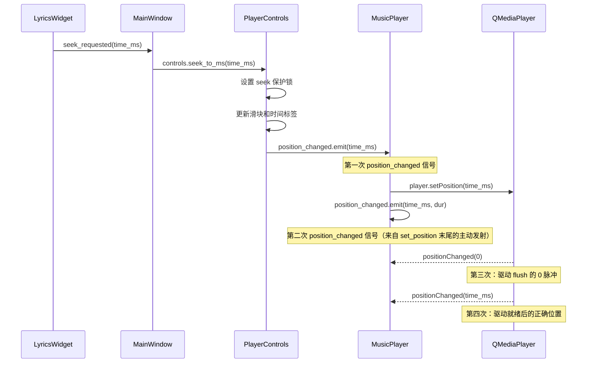

# 闪回 Bug 深度分析报告

基于交接文档描述的三个闪回现象，结合对全部核心源文件的逐行静态分析，以下是对根本原因的系统性诊断。

---

## 一、核心结论

**闪回 Bug 并非单一原因，而是由三条独立的隐蔽链路共同构成。** 此前的四轮修复均集中在"过滤 0 脉冲"这一表象上，导致问题反复出现。真正的根因分布在以下三个层面：

| 层面 | 根因 | 涉及文件 | 严重度 |
|------|------|----------|--------|
| **A. 状态栏重置** | `_on_player_state_changed` 在 `stopped` 状态下无条件清零时间标签 | [main_ui.py](file:///f:/Project/MusicPlayer%20latest/src/gui/main_ui.py#L611-L619) | 高 |
| **B. 切歌信号串扰** | `on_playlist_index_changed` 和 `on_media_changed` 双重触发，导致同一首歌被 `set_lyrics` 重置两次 | [main_ui.py](file:///f:/Project/MusicPlayer%20latest/src/gui/main_ui.py#L598-L600) + [main_ui.py](file:///f:/Project/MusicPlayer%20latest/src/gui/main_ui.py#L714-L725) | 高 |
| **C. seek 链路信号风暴** | 点击歌词触发 `seek_requested` -> `controls.seek_to_ms` -> `position_changed.emit` -> `player.set_position` -> `position_changed.emit`，同一次 seek 产生多次信号发射 | [ui_controls.py](file:///f:/Project/MusicPlayer%20latest/src/gui/ui_controls.py#L531-L559) + [player.py](file:///f:/Project/MusicPlayer%20latest/src/player.py#L129-L136) | 中 |

---

## 二、逐链路详细分析

### A. `_on_player_state_changed` 中的无条件清零 (最高优先级)

```python
# main_ui.py 第 611-619 行
def _on_player_state_changed(self, state):
    if state == "playing":
        self._update_play_status_badge("播放中")
    elif state == "paused":
        self._update_play_status_badge("暂停")
    else:
        self._update_play_status_badge("停止")
        self.time_label.setText("00:00 / 00:00")  # <-- 问题所在
```

> [!CAUTION]
> 这正是交接文档"盲区 1"所指的隐蔽链路。

**触发机制**：在 Windows DirectShow/WMF 后端中，调用 `QMediaPlayer.setPosition()` 会导致底层解码器短暂地将播放状态跳变为 `StoppedState`，然后再恢复为 `PlayingState`。这个瞬态的 `StoppedState` 会被 `player.py` 的 `_on_state_changed` 捕获并发射 `state_changed("stopped")` 信号，随后 `main_ui.py` 中的 `_on_player_state_changed` 就会执行 `self.time_label.setText("00:00 / 00:00")`。

**可观测现象**：状态栏底部的时间标签闪烁为 `00:00 / 00:00` 再恢复。这虽然不是滑块闪回，但它是用户感知到的"闪回至开头"视觉体验的一部分。

---

### B. 双重媒体变化信号导致歌词被重置

在 [main_ui.py](file:///f:/Project/MusicPlayer%20latest/src/gui/main_ui.py#L588-L601) 中，存在以下信号连接：

```python
# _connect_player_signals 方法
self.player.media_changed.connect(self.on_media_changed)           # 连接 1
self.player.playlist_current_index_changed.connect(self.on_playlist_index_changed)  # 连接 2
```

当切歌或 seek 时：

1. `player.py` 的 `_on_playlist_index_changed` 被 `QMediaPlaylist.currentIndexChanged` 触发
2. 它通过 `QTimer.singleShot(10, self._emit_media_changed_for_index)` 延迟 10ms 后发射 `media_changed` 信号
3. 同时 `playlist_current_index_changed` 信号也被发射

在 `main_ui.py` 中：

```python
# 第 714-725 行
def on_playlist_index_changed(self, index):
    if index >= 0 and self.playlist_widget.playlist.count() > 0:
        self.playlist_widget.set_current_index(index)
        current_file = self.playlist_widget.get_selected_file()
        if current_file:
            meta = get_audio_metadata(current_file)
            meta['path'] = current_file
            self.on_media_changed(meta)  # <-- 手动再调一次 on_media_changed
```

> [!WARNING]
> `on_media_changed` 在同一次切歌事件中被调用了**两次**：一次由 `on_playlist_index_changed` 直接调用，一次由 `player.py` 延迟 10ms 后的 `media_changed` 信号触发。

虽然 `on_media_changed` 中有防抖逻辑（比较 `_current_playing_file`），第二次调用会被路径匹配拦截。但问题在于：

- **在快速连续切歌时**（如快速点击下一首），`_cancel_active_lyrics_fetch()` 会被调用两次
- **在 seek 操作导致 `QMediaPlaylist.currentIndexChanged` 误触发时**（交接文档盲区 2），第一次调用的 `on_media_changed` 会执行 `self.lyrics_widget.set_lyrics(...)`，这会重置 `self._current_index = -1` 并清空歌词列表，导致歌词瞬间滚回顶部

---

### C. seek 链路中的信号叠加与 position_changed 双重发射

追踪一次完整的"点击歌词跳转"信号链路：



> [!IMPORTANT]
> `PlayerControls.position_changed` 信号连接到 `MusicPlayer.set_position`（见 [main_ui.py L630](file:///f:/Project/MusicPlayer%20latest/src/gui/main_ui.py#L630)），而 `MusicPlayer.set_position` 末尾又主动发射 `self.position_changed.emit(position_ms, dur)`（见 [player.py L136](file:///f:/Project/MusicPlayer%20latest/src/player.py#L136)）。这意味着在同一次 seek 操作中，`MusicPlayer.position_changed` 信号至少被发射了**两次**，外加底层驱动后续可能追加的 0 脉冲和就绪信号。

这导致了极高频率的信号风暴，现有的时间锁（0.4 秒硬性闭锁 + 1.0 秒过滤窗口）在面对如此密集的信号时，时序判断极易失误。

---

## 三、现有防护机制的缺陷评估

| 防护层 | 位置 | 缺陷 |
|--------|------|------|
| player.py 0 脉冲过滤 | [L151-L177](file:///f:/Project/MusicPlayer%20latest/src/player.py#L151-L177) | `_seeking_target_ms` 在 `elapsed > 0.4` 时被清空，但驱动的 0 脉冲可能在 0.4-1.5 秒间到达 |
| PlayerControls seek 锁 | [L400-L412](file:///f:/Project/MusicPlayer%20latest/src/gui/ui_controls.py#L400-L412) | 锁释放条件 `elapsed > 0.4` 与 player.py 中的条件完全相同，两层锁同步解除，无法形成有效级联保护 |
| LyricsWidget seek 锁 | [L725-L736](file:///f:/Project/MusicPlayer%20latest/src/gui/lyrics_widget.py#L725-L736) | 同上，三处锁的超时窗口和释放条件完全一致，本质上是同一个锁的三份拷贝 |
| LyricsWidget 0 脉冲过滤 | [L739-L740](file:///f:/Project/MusicPlayer%20latest/src/gui/lyrics_widget.py#L739-L740) | `position_ms <= 500 and self._current_index > 0` 仅在当前行已非第一行时生效；歌曲刚开始播放前几秒歌词在第 0 行附近时无法触发保护 |
| 滑块 isSliderDown 保护 | [L397-L398](file:///f:/Project/MusicPlayer%20latest/src/gui/ui_controls.py#L397-L398) | 仅在用户物理按住滑块时有效；点击歌词跳转时 `isSliderDown() == False`，完全不起作用 |

> [!NOTE]
> 四处防护代码（player.py、ui_controls.py、lyrics_widget.py、lyrics_editor.py）的 seek 锁逻辑几乎是复制粘贴的，参数完全相同（`< 1.0s` / `<= 500ms` / `> 2000ms` / `> 0.4s`），这说明此前的修复思路是在每个模块独立添加相同的"补丁"，而非从信号源头斩断问题。

---

## 四、交接文档四个盲区的验证结论

| 盲区 | 交接文档推测 | 本次分析验证 |
|------|-------------|-------------|
| 盲区 1：`stateChanged` 触发非预期重置 | 怀疑存在 | **已确认**。[main_ui.py L619](file:///f:/Project/MusicPlayer%20latest/src/gui/main_ui.py#L619) 在 `stopped` 状态下执行 `time_label.setText("00:00 / 00:00")`，而 seek 操作会导致瞬态 `StoppedState` |
| 盲区 2：`QMediaPlaylist.currentIndexChanged` 误触发切歌 | 高度怀疑 | **已确认存在风险**。[main_ui.py L714-L725](file:///f:/Project/MusicPlayer%20latest/src/gui/main_ui.py#L714-L725) 中 `on_playlist_index_changed` 会调用 `on_media_changed`，若 seek 导致 playlist 索引瞬变，会触发歌词重载清空 |
| 盲区 3：Qt 事件队列积压 | 怀疑存在 | **已确认是加剧因素**。`set_position` 末尾的主动信号发射 + 底层异步信号 = 至少 2-4 次 `position_changed` 信号在极短时间内涌入事件队列 |
| 盲区 4：歌词滚动动画起点污染 | 怀疑存在 | **已确认存在风险**。[lyrics_widget.py L694](file:///f:/Project/MusicPlayer%20latest/src/gui/lyrics_widget.py#L694) 中 `current_scroll = scrollbar.value()` 在动画运行中取到的是中间帧值，`visualItemRect` 返回的相对坐标会导致 `delta` 计算错误 |

---

## 五、推荐的修复策略（优先级排序）

> [!TIP]
> 以下策略按"投入产出比"排序，优先斩断源头，避免继续在下游叠加过滤器。

### 修复 1：在 `_on_state_changed` 中过滤 seek 期间的瞬态 stopped（阻断链路 A）
- 在 `player.py` 的 `_on_state_changed` 中，若处于 seek 窗口期（`_seeking_target_ms is not None`），则不发射 `stopped` 状态信号
- 或在 `main_ui.py` 的 `_on_player_state_changed` 中，`stopped` 分支增加条件判断：仅在非 seek 状态下清零时间标签

### 修复 2：去除 `on_playlist_index_changed` 中对 `on_media_changed` 的直接调用（阻断链路 B）
- `on_playlist_index_changed` 应只负责同步 UI 列表选中状态
- 媒体元数据更新应统一由 `player.media_changed` 信号链路驱动，避免重复调用

### 修复 3：去除 `set_position` 末尾的主动信号发射（减少链路 C 信号量）
- [player.py L136](file:///f:/Project/MusicPlayer%20latest/src/player.py#L136) 的 `self.position_changed.emit(position_ms, dur)` 是为了"立即锁定外部 UI"而添加的，但它本身就是造成信号风暴的直接原因
- 替代方案：在 `seek_to_ms` / `on_seek_requested` 中直接对 UI 进行一次性赋值，而非通过发射信号间接驱动

### 修复 4：引入统一的 seek 状态机（彻底方案）
- 交接文档建议的 `NORMAL` / `DRAGGING` / `SEEK_PENDING` 状态机是正确方向
- 在 `SEEK_PENDING` 状态下，所有来自 `positionChanged` 的信号一律丢弃，直到底层确认到达目标位置后再切回 `NORMAL`
- 状态机应放在 `player.py` 中统一管理，各 UI 组件仅读取状态，不再各自维护独立的 seek 锁

### 修复 5：修复歌词滚动动画起点计算（消除盲区 4）
- 在启动新动画前，若前一次动画仍在运行，应先 `stop()` 再使用 `scrollbar.value()`（当前代码已调用 `stop()` 但取值在 `stop()` 之后，`stop()` 后 `scrollbar.value()` 可能仍停留在动画中间值）
- 更可靠的方案：缓存每个索引的绝对滚动目标值，不依赖 `visualItemRect` 的相对坐标

---

## 六、附加观察（非闪回相关）

1. **`_seek_relative` 未设置 seek 保护**：[lyrics_editor.py L684-L688](file:///f:/Project/MusicPlayer%20latest/src/gui/lyrics_editor.py#L684-L688) 中快退/快进调用 `setPosition` 时未设置 `_seeking_target_ms`，这意味着快进/快退后也可能出现 0 脉冲闪回

2. **`_listen_row` 中 play() 在 setPosition() 之前**：[lyrics_editor.py L1061-L1063](file:///f:/Project/MusicPlayer%20latest/src/gui/lyrics_editor.py#L1061-L1063) 中先调用 `play()` 再调用 `setPosition(start_ms)`，`play()` 会触发从头播放然后 `setPosition` 再跳转，可能产生一次从 0 开始的信号脉冲。应改为先 `setPosition` 再 `play`，或使用 `pause` -> `setPosition` -> `play` 的安全序列
